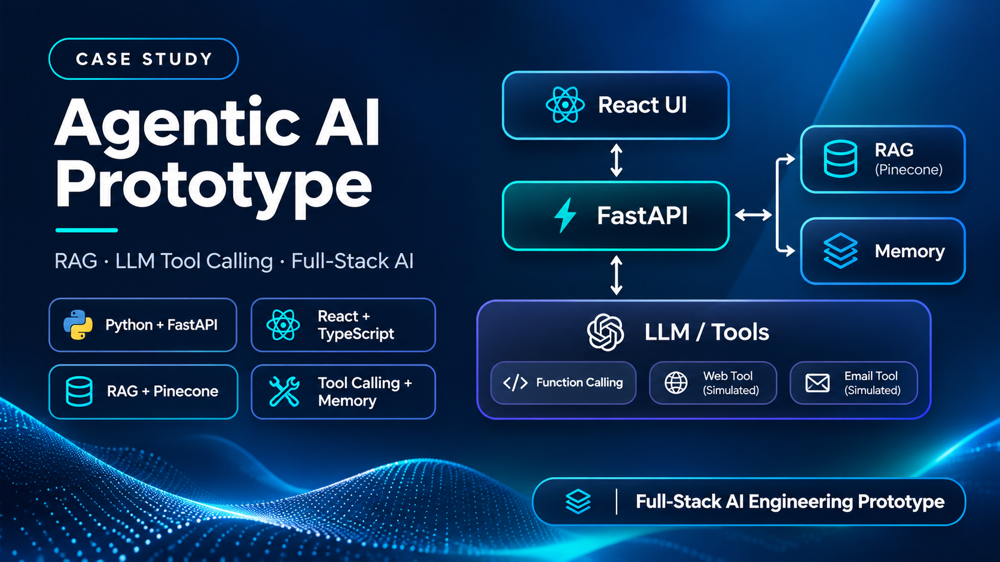
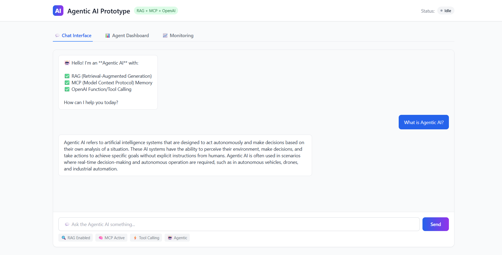
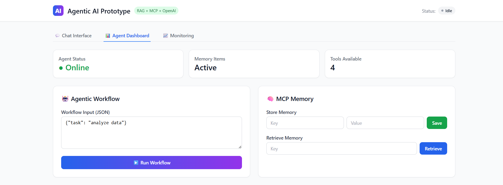
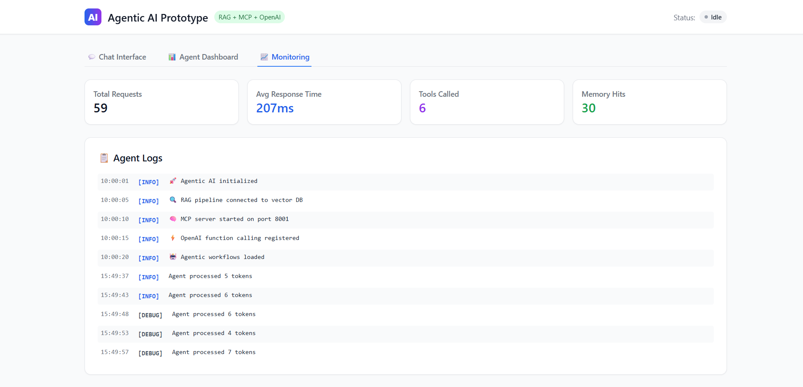

# 🤖 Agentic AI Prototype

[](https://opensource.org/licenses/MIT)
[](https://www.python.org/downloads/)
[](https://reactjs.org/)
[](https://fastapi.tiangolo.com/)
[](https://openai.com/)
[](https://www.pinecone.io/)
[](https://railway.app)
[](https://vercel.com)
 


> 🚀 **Live Demo:** [Frontend](https://agentic-ai-prototype.vercel.app) | [Backend API](https://agentic-ai-prototype-production-1c87.up.railway.app) | [API Docs](https://agentic-ai-prototype-production-1c87.up.railway.app/docs)

---

## 🎯 Overview

This project is a fully functional **Agentic AI** system that combines:

| Component | Description |
|-----------|-------------|
| **🤖 Agentic AI** | Autonomous decision-making and workflow execution |
| **🔍 RAG** | Retrieval-Augmented Generation for contextual document retrieval |
| **🧠 MCP** | Model Context Protocol Servers for persistent agent memory |
| **⚡ OpenAI** | Function/Tool calling for real-world actions |
| **🎨 UI** | Modern React + TypeScript interface for agent interaction |

**Live Links:**
- **Frontend UI:** [https://agentic-ai-prototype.vercel.app](https://agentic-ai-prototype.vercel.app)
- **Backend API:** [https://agentic-ai-prototype-production-1c87.up.railway.app](https://agentic-ai-prototype-production-1c87.up.railway.app)
- **API Documentation (Swagger):** [https://agentic-ai-prototype-production-1c87.up.railway.app/docs](https://agentic-ai-prototype-production-1c87.up.railway.app/docs)

---

## 🧪 How to Use — Sample Questions

Once you open the frontend, you can ask the AI agent these questions to test its capabilities:

### 🔍 Test RAG (Retrieval-Augmented Generation)

The AI has been pre-loaded with sample documents about:
- Agentic AI
- RAG
- MCP
- Urban Resilience
- Digital Twins

Ask:

| **Question** | **Expected Response** |
|---|---|
| `What is Agentic AI?` | The AI will retrieve the document about Agentic AI and answer based on it. |
| `What is RAG?` | The AI will retrieve the RAG document and explain it. |
| `What is MCP?` | The AI will retrieve the MCP document and explain it. |
| `What is urban resilience?` | The AI will retrieve the urban resilience document. |
| `What are digital twins?` | The AI will retrieve the digital twins document. |

### 🧠 Test MCP Memory

You can store and retrieve information in the agent's persistent memory:

| **Question** | **Expected Behavior** |
|---|---|
| `Save to memory: my_favorite_color = blue` | The AI will save `my_favorite_color = blue` to its memory. |
| `What is my favorite color?` | The AI will retrieve `blue` from memory and respond. |
| `Save to memory: user_name = Muhammad` | The AI will store your name. |
| `What is my name?` | The AI will recall your name. |

### ⚡ Test OpenAI Function/Tool Calling

The AI can perform real-world actions:

| **Question** | **Expected Behavior** |
|---|---|
| `Search the web for Python programming` | The AI will call the `search_web` tool and show simulated results. |
| `Analyze this data: {"sales": 1000, "profit": 200}` | The AI will call the `analyze_data` tool. |
| `Send an email to test@example.com with subject "Hello" and body "This is a test"` | The AI will call the `send_email` tool (simulated). |

### 🤖 Test Agentic Workflow

You can run a multi-step autonomous workflow:

| **Question** | **Expected Behavior** |
|---|---|
| `Run workflow for task: plan a project` | The AI will execute a predefined workflow (analyze → decide → execute). |

---

## 🖥️ Screenshots

- **Chat Interface:** 
- **Agent Dashboard:** 
- **Monitoring Panel:** 

---

## 🛠️ Tech Stack

### Backend
| Technology | Purpose |
|------------|---------|
| Python 3.11+ | Core language |
| FastAPI | REST API framework |
| OpenAI API | LLM and function calling |
| Pinecone | Vector database for RAG |
| Uvicorn | ASGI server |

### Frontend
| Technology | Purpose |
|------------|---------|
| React 18 | UI framework |
| TypeScript | Type safety |
| Tailwind CSS | Styling |
| Vite | Build tool |
| Axios | HTTP client |
| LocalStorage | Chat history persistence |

### Infrastructure
| Technology | Purpose |
|------------|---------|
| Docker | Containerization |
| Railway | Backend deployment |
| Vercel | Frontend deployment |

---

## 📁 Project Structure

```
agentic-ai-prototype/
├── backend/
│   ├── app.py              # FastAPI server
│   ├── requirements.txt    # Python dependencies
│   ├── .env.example        # Environment variables
│   ├── upload_documents.py # Pinecone upload script
│   └── Dockerfile          # Backend container
├── frontend/
│   ├── src/
│   │   ├── components/     # React components
│   │   ├── api/            # API client
│   │   ├── App.jsx         # Main app
│   │   └── main.jsx        # Entry point
│   ├── package.json        # Node dependencies
│   ├── vite.config.js      # Vite config
│   └── Dockerfile          # Frontend container
├── docker-compose.yml      # Multi-container setup
└── README.md               # This file
```

---

## 🚀 Quick Start (Local Development)

### Prerequisites

- Python 3.11+
- Node.js 18+
- OpenAI API Key
- (Optional) Pinecone API Key for real RAG

### 1. Clone the Repository

```bash
git clone https://github.com/muhammadshiraz/agentic-ai-prototype.git
cd agentic-ai-prototype
```

### 2. Backend Setup

```bash
cd backend
python -m venv venv311
source venv311/bin/activate  # On Windows: venv311\Scripts\activate
pip install -r requirements.txt
cp .env.example .env
# Edit .env and add your OPENAI_API_KEY
python app.py
```

### 3. Frontend Setup

```bash
cd frontend
npm install
npm run dev
```

### 4. Open Your Browser

- Frontend: http://localhost:5173
- Backend API: http://localhost:8000
- API Docs: http://localhost:8000/docs

---

## 📡 API Endpoints

| Method | Endpoint | Description |
|--------|----------|-------------|
| GET | `/` | Health check |
| POST | `/api/chat` | Chat with Agentic AI |
| POST | `/api/agent/workflow` | Run agentic workflow |
| POST | `/api/memory/store` | Store memory |
| GET | `/api/memory/retrieve/{key}` | Retrieve memory |
| GET | `/api/memory/list` | List all memory |
| DELETE | `/api/memory/delete/{key}` | Delete memory |

---

## 🌐 Deployment

### Backend (Railway)

1. Sign up at [Railway.app](https://railway.app) (free, no credit card required)
2. Deploy from GitHub repository
3. Set Root Directory: `backend/`
4. Add environment variables:
   - `OPENAI_API_KEY`
   - `PINECONE_API_KEY` (optional)
   - `PINECONE_ENVIRONMENT` (optional)
   - `PINECONE_INDEX` (optional)

### Frontend (Vercel)

1. Sign up at [Vercel.com](https://vercel.com) (free)
2. Import your GitHub repository
3. Set Root Directory: `frontend/`
4. Framework Preset: `Vite`
5. Add environment variable: `VITE_API_URL` = your Railway backend URL + `/api`

---

## 📊 Features

- ✅ **Agentic AI** — Autonomous decision-making and workflow execution
- ✅ **RAG Pipelines** — Contextual document retrieval for accurate responses
- ✅ **MCP Servers** — Persistent memory for stateful interactions
- ✅ **OpenAI Function Calling** — Real-world tool execution
- ✅ **Full Stack** — Python FastAPI + React TypeScript
- ✅ **Modern Stack** — Tailwind CSS, Vite, Docker
- ✅ **Engineering Prototype** — Demonstrates AI workflows, retrieval, tool calling, and full-stack integration; production hardening remains on the roadmap.
- ✅ **Containerized** — Docker and Docker Compose support
- ✅ **Chat History Persistence** — LocalStorage for conversation history
- ✅ **Clear History Button** — Reset conversation anytime

---

## 🚧 Roadmap

- [ ] Add WebSocket support for real-time streaming
- [ ] Add authentication and user sessions
- [ ] Add more tools (Slack, Notion, GitHub, etc.)
- [ ] Add agent memory persistence to database
- [ ] Add CI/CD pipeline with GitHub Actions

---

## 🤝 Contributing

Pull requests are welcome. For major changes, please open an issue first.

1. Fork the repository
2. Create a feature branch (`git checkout -b feature/amazing-feature`)
3. Commit your changes (`git commit -m 'Add some amazing feature'`)
4. Push to the branch (`git push origin feature/amazing-feature`)
5. Open a Pull Request

---

## 📄 License

This project is licensed under the MIT License - see the [LICENSE](LICENSE) file for details.

---

## 🔗 Connect with Me

- **GitHub:** [github.com/muhammadshiraz](https://github.com/muhammadshiraz)
- **LinkedIn:** [linkedin.com/in/muhammadshiraz](https://linkedin.com/in/muhammadshiraz)
- **Email:** muhammadshiraz996@gmail.com

---

## ⭐ Show Your Support

If you found this project useful, please consider giving it a ⭐ on GitHub!

---

## 📝 Acknowledgments

- [OpenAI](https://openai.com) for the LLM API
- [FastAPI](https://fastapi.tiangolo.com) for the backend framework
- [React](https://reactjs.org) for the frontend UI
- [Tailwind CSS](https://tailwindcss.com) for the styling
- [Pinecone](https://www.pinecone.io) for the vector database
- [Railway](https://railway.app) for backend hosting
- [Vercel](https://vercel.com) for frontend hosting

---

**Built with ❤️ by Muhammad Shiraz**
